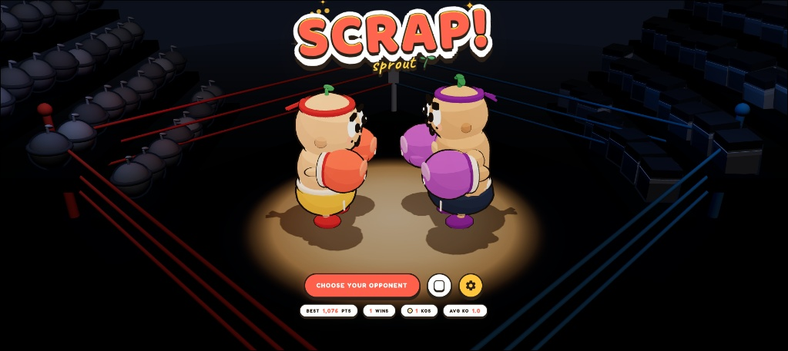
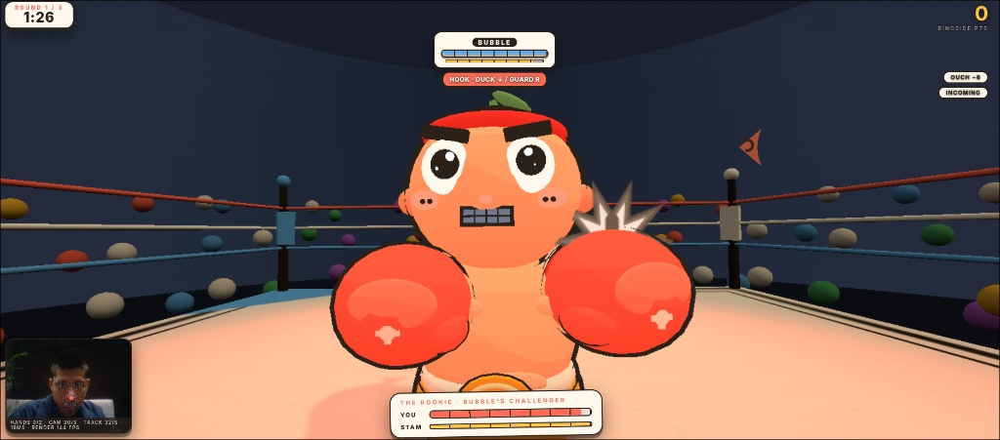
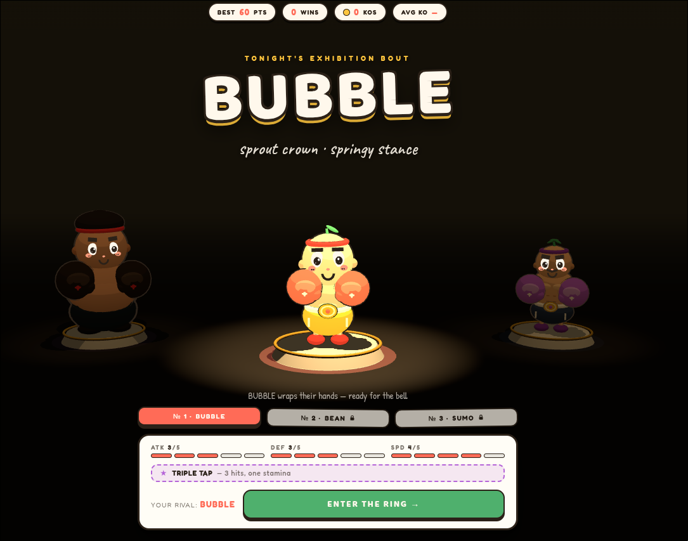
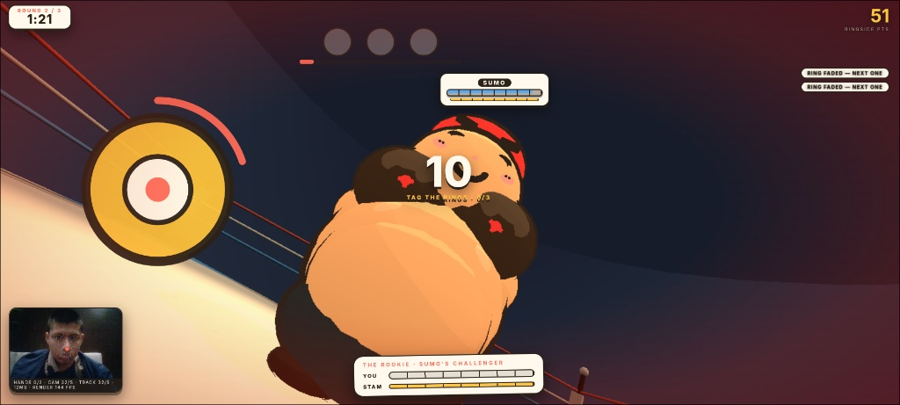
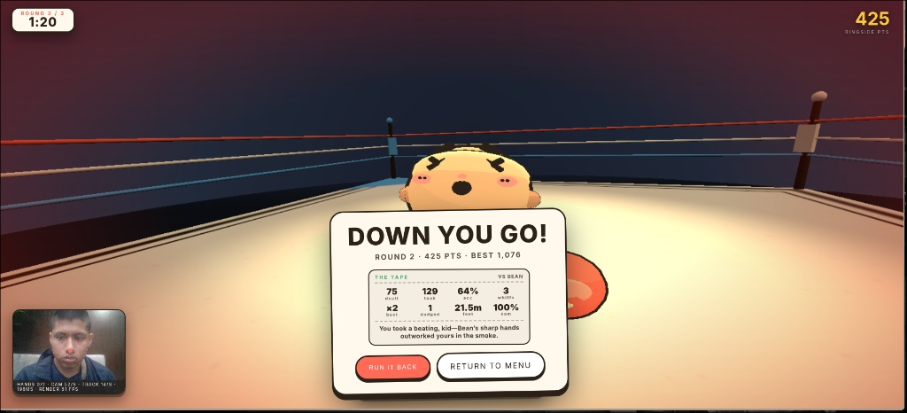
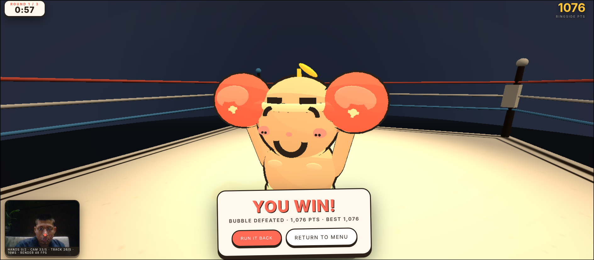

# SCRAP! 🥊

> **Webcam-driven first-person boxing in the browser.** Throw real punches at the camera, lean and duck to dodge incoming strikes, and hear dynamic corner coaching and rival banter.

Deployed live on a custom domain registered via GoDaddy Registry, **SCRAP!** turns everyday webcams into serious gaming hardware without requiring specialized peripherals.



---

## Inspiration

Every boxing game ever made asks you to memorize which button throws a hook. We wanted to know: what if you just *threw the punch*? **SCRAP!** is our answer — an immersive first-person boxing experience running entirely in your browser where your webcam acts as the controller, your head movement dictates spatial dodges, and your fists deliver real strikes.

---

## What it does

Step straight into a stylized ring and fight using physical perception and real-world movement:

- **Punch the camera** — A fist surging toward the lens registers as an authentic strike, dynamically scaling hit power and knockback by real-world velocity.
- **Physical head and body tracking** — Lean forward to pressure inside, lean back to make rivals swing at air, or duck and slip beneath telegraphed combinations.
- **Dynamic AI commentary & rival dialogue** — Rivals taunt, adapt, and react with realistic vocal personalities powered by ElevenLabs, driven by round-by-round fight intelligence orchestrated with the Gemini API.
- **Serious game & perception simulation** — Full 3-round bout simulation tracking stamina consumption, guard blocks, combo streaks, knockdowns, and ringside scoring under Full Sail's Pathways & Perception challenge guidelines.
- **Unlockable career progression** — Climb the ladder against unique procedural archetypes, from sharp counter-snipers to towering heavyweight brawlers.
- **Accessible controls** — Seamless fallback support for mouse and keyboard controls alongside a sparring tutorial mode.

| In-Ring Combat & Telegraph Dodging | Rival Exhibition Lineup |
| :---: | :---: |
|  |  |

| Beat the Count QTE Minigame | "The Tape" Post-Bout Stats & AI Analysis |
| :---: | :---: |
|  |  |



---

## How we built it

Everything is hand-rolled web tech engineered for lightweight, zero-dependency performance:

- **Open-Source Computer Vision (Hugging Face):** Deployed open-source computer vision and pose-estimation models from Hugging Face directly in the browser to extract 21 hand landmarks and 6-DOF head poses for real-time punch recognition, slips, and dodges.
- **Intelligent Audio & Strategy (ElevenLabs & Gemini API):** Fighter dialogue, corner coaching, and play-by-play commentary are dynamically generated using the Gemini API and vocalized via ElevenLabs' expressive speech synthesis.
- **UI/UX & Visual Identity (Figma & Adobe):** The visual aesthetic was prototyped and designed in Figma, with custom-crafted shaders, bold stylized UI, and vibrant visual effects built to Adobe design standards for an arcade look.
- **Deterministic 3D Simulation (Three.js & Full Sail Challenge):** Built a custom 2D-to-3D ring simulation with lane-pull steering, reach calculations, and spatial boundaries in Three.js to address the Full Sail Pathways & Perception serious games and simulation challenge.
- **Deployment & Production:** The platform is hosted and served live on a dedicated custom domain using GoDaddy Registry.
- **Procedural Sound & Headless CI:** Procedural WebAudio handles glove impacts, bells, and rope creaks, while Puppeteer automated tests run headless bouts to verify tracking accuracy.

---

## Challenges we ran into

- **Client-Side Open-Source Vision Inference:** Running Hugging Face vision models directly inside the browser at high frame rates required aggressive optimization, frame skipping, and quantization to avoid frame drops on integrated GPUs.
- **Webcam noise & punch gating:** Distinguishing standard hand movement from high-velocity strikes required pairing bounding-box expansion heuristics with strict fist-closure thresholds.
- **First-person perspective tuning:** Keeping agile opponents framed inside a front-facing viewing cone while they circle and pivot required an intelligent lane-pull steering layer inside the ring simulation.
- **Synchronizing real-time voice and gameplay:** Streaming ElevenLabs voice commentary alongside the Gemini API's fight analysis without interrupting active Three.js rendering loops.

---

## What we learned

Game feel relies heavily on micro-feedback: hit-stop freezes, rope jolts, telegraph flashes, and dynamic ringside banter. We also discovered that pairing open-source AI with deterministic simulation makes vision-driven physical gameplay fully testable in automated pipelines.

---

## What's next

- Dynamic difficulty adjustments tailored live to player reaction speeds.
- True southpaw stance toggles and branching tournament ladders.
- Expanded AI coach commentary with deeper post-fight strategy breakdowns.

---

## Quickstart & Local Development

```bash
# Clone the repository and submodules
git clone --recurse-submodules https://github.com/Anthony-Sin/unclockable-knighthacks-2026.git
cd unclockable-knighthacks-2026/spatial-objects

# Install dependencies (puppeteer for tests)
npm install

# Start the local server
node server.mjs

# Open in your browser
# http://127.0.0.1:8791/boxing.html (or http://127.0.0.1:8791/ for the main hub)
```
